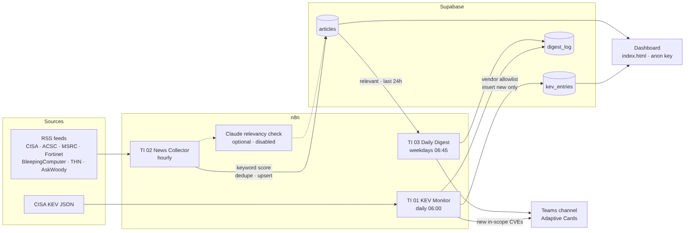

# Threat Intel Pipeline (n8n + Supabase + Teams)

Replaces the daily "open eight websites" routine with three n8n workflows that collect, filter and post
only what is relevant to our client environments. Keyword/vendor filtering only in this version; an
AI relevancy step is wired in but disabled.



## What it does

| Workflow | Schedule | What happens |
|---|---|---|
| **TI 01 – KEV Monitor** | daily 06:00 | Pulls the CISA KEV JSON, keeps entries whose vendor/product is in our allowlist, inserts new ones into `kev_entries`, posts the new ones to Teams. Supabase returns only rows it inserted, so there's no "seen list" to maintain. |
| **TI 02 – News Collector** | hourly | Reads 8 RSS feeds, dedupes by link, scores each article against the vendor allowlist and high-signal terms (zero-day, actively exploited, ransomware, Australia, MSP…), upserts into `articles` with the score and matched terms. |
| **TI 03 – Daily Digest** | weekdays 06:45 | Reads relevant articles from the last 24 h, groups by source, posts one Adaptive Card to Teams. |

The dashboard (`dashboard/index.html`) reads both tables with the anon key and shows KEV hits,
kept/dropped articles and *why* each was kept.

## Setup (about 20 minutes)

### 1. Supabase
1. Open the SQL editor in your Supabase project and run `supabase/schema.sql`.
2. Note the **Project URL**, the **service_role** key (for n8n) and the **anon** key (for the dashboard).

### 2. Teams webhook
In the target channel: **… → Workflows → "Post to a channel when a webhook request is received"**.
Copy the webhook URL. (The old "Incoming Webhook" connector is retired; the Workflows one accepts the
same Adaptive Card payload these workflows send.)

### 3. n8n
1. **Workflows → Import from file** for each of `n8n/01-kev-monitor.json`, `02-news-collector.json`, `03-daily-digest.json`.
2. In each workflow open the **Config** node and fill in `SUPABASE_URL`, `SUPABASE_SERVICE_KEY`,
   `TEAMS_WEBHOOK`, `DASHBOARD_URL`. Adjust `VENDOR_ALLOWLIST` / `SIGNAL_TERMS` / `MIN_SCORE` to taste.
   (For the demo the config lives in a Code node so there's nothing else to click. Before production,
   move the keys into n8n Credentials or Variables.)
3. Run **TI 01** once manually. The first run stores the whole in-scope backlog but only posts entries
   added in the last `KEV_LOOKBACK_DAYS` (14) to Teams.
4. Run **TI 02** once manually, then **TI 03** to see the first digest.
5. Activate all three.

### 4. Dashboard
Open `dashboard/index.html`, set `SUPABASE_URL` and `SUPABASE_ANON_KEY` at the top of the script.
Host it anywhere static (SharePoint site asset, GitHub Pages, S3, an internal web server) or just open it
from a file share. Without keys it shows built-in sample data, which is handy for the demo.

## Demo script (10 minutes)

1. Show the current manual process (the list of sites).
2. Open **TI 01**, click *Execute workflow*, show the Filter node output (`total_in_catalog` vs `in_scope`),
   then the Teams card that appears.
3. Open **TI 02**, execute, show the Score node output (score, matched terms, relevant flag), point out
   the dropped items.
4. Open the dashboard: tiles → KEV table → articles with "why it was kept".
5. Show the disabled Claude node and explain the optional AI step (Max plan includes US$100/month API credit).
6. Ask for feedback on the allowlist and score threshold.

## Tuning

- **Too noisy?** raise `MIN_SCORE` (default 3) or remove broad allowlist terms like `"Google"`, `"Linux"`.
- **Missing things?** add the product names your clients run to `VENDOR_ALLOWLIST`; add feeds to the
  `Feed list` node in TI 02 (any RSS/Atom URL works; source label comes from the hostname).
- **Enable AI**: set `AI_ENABLED: true` in the TI 02 Config node, put the API key in the
  *Claude relevancy check* node, enable the node. Then add a small Code node after it to write
  `ai_verdict` / `ai_reason` back to `articles` (left out so the demo stays keyword-only).

## Next step after the demo

Cross-match new KEV CVEs against NinjaOne vulnerability data per client organisation so the Teams
card says "CVE-2026-xxxx – 14 devices across 3 clients" instead of just listing the CVE.

## Files

```
n8n/01-kev-monitor.json      n8n/02-news-collector.json      n8n/03-daily-digest.json
supabase/schema.sql          dashboard/index.html            docs/architecture.mmd / .png
```

## Feed URLs used

| Source | URL |
|---|---|
| CISA KEV | https://www.cisa.gov/sites/default/files/feeds/known_exploited_vulnerabilities.json |
| CISA advisories | https://www.cisa.gov/cybersecurity-advisories/cybersecurity-advisories.xml |
| ASD ACSC alerts | https://www.cyber.gov.au/rss/alerts |
| ASD ACSC advisories | https://www.cyber.gov.au/rss/advisories |
| MSRC Security Update Guide | https://api.msrc.microsoft.com/update-guide/rss |
| Fortinet PSIRT | https://filestore.fortinet.com/fortiguard/rss/ir.xml |
| BleepingComputer | https://www.bleepingcomputer.com/feed/ |
| The Hacker News | https://feeds.feedburner.com/TheHackersNews |
| AskWoody | https://www.askwoody.com/feed/ |
